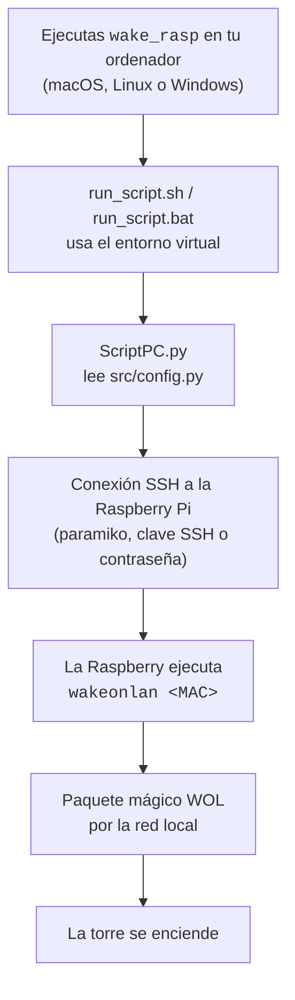

# Raspberry Pi - Wake-on-LAN Bridge


Enciende un ordenador de tu red local (por ejemplo, una torre) con un solo comando, usando una Raspberry Pi siempre encendida como puente. El script se conecta a la Raspberry por SSH y le pide que envíe el paquete mágico Wake-on-LAN (WOL) al equipo.

Es útil cuando el equipo desde el que lanzas la orden no puede enviar el paquete WOL directamente (por ejemplo, porque está en otra red o conectado por VPN), pero sí puede llegar a la Raspberry por SSH.

---

## Índice

- [Cómo funciona](#cómo-funciona)
- [Características](#características)
- [Estructura del proyecto](#estructura-del-proyecto)
- [Requisitos](#requisitos)
- [Preparar la Raspberry Pi y la torre](#preparar-la-raspberry-pi-y-la-torre)
- [Instalación](#instalación)
- [Configuración](#configuración)
- [Uso](#uso)
- [Solución de problemas](#solución-de-problemas)
- [Seguridad](#seguridad)
- [Uso de IA](#uso-de-ia)
- [Licencia](#licencia)

---

## Cómo funciona



La Raspberry Pi está siempre encendida y en la misma red local que la torre, así que sirve de puente: tú solo necesitas poder llegar a ella por SSH.

## Características

- Funciona en macOS, Linux y Windows (solo depende de Python y `paramiko`).
- Autenticación con clave SSH (recomendado) o contraseña.
- Verifica la clave del host contra `~/.ssh/known_hosts` y rechaza servidores desconocidos.
- Los datos personales viven en `src/config.py`, que está en el `.gitignore`.
- Devuelve código de salida `0` si el paquete se envió y `1` si algo falló, así que se puede usar desde otros scripts.

## Estructura del proyecto

```text
.
├── run_script.sh          # Lanzador para macOS y Linux
├── run_script.bat         # Lanzador para Windows
├── setup.sh               # Instalación automática (macOS y Linux)
├── requirements.txt       # Dependencias con versión fija
└── src/
    ├── ScriptPC.py        # Conexión SSH y envío del WOL
    ├── config_example.py  # Plantilla de configuración
    └── config.py          # Tus datos (lo creas tú, no se sube a git)
```

## Requisitos

**En tu ordenador**

- Python 3.11 o superior.
- En Debian/Ubuntu puede hacer falta el módulo de entornos virtuales: `sudo apt install python3-venv`.

**En la Raspberry Pi**

- Servidor SSH activo (`sudo raspi-config` → *Interface Options* → *SSH*).
- `wakeonlan` instalado:

```bash
sudo apt install wakeonlan
```

**En la torre**

- Wake-on-LAN activado en la BIOS/UEFI y en la tarjeta de red.
- Conectada por cable a la misma red que la Raspberry (WOL por Wi-Fi casi nunca funciona).

## Preparar la Raspberry Pi y la torre

1. **Averigua la MAC de la torre** (la de la tarjeta de red por cable):
   - Windows: `ipconfig /all` → *Dirección física*.
   - Linux: `ip link`.
   - macOS: `ifconfig en0 | grep ether`.
2. **Activa WOL en la torre:**
   - BIOS/UEFI: busca opciones como *Wake on LAN*, *Power On By PCI-E* o *Resume by LAN*.
   - Windows: en el Administrador de dispositivos, en las propiedades del adaptador de red, activa *Wake on Magic Packet* y *Permitir que este dispositivo reactive el equipo*. Si falla, desactiva el *Inicio rápido* en las opciones de energía.
   - Linux: `sudo ethtool -s <interfaz> wol g`.
3. **Prueba desde la Raspberry** que el paquete funciona antes de usar el script:

```bash
wakeonlan <MAC_DE_LA_TORRE>
```

4. **Dale una IP fija a la Raspberry** (reserva DHCP en el router) para que `raspberry_ip` no cambie.

## Instalación

### macOS y Linux (automática)

```bash
./setup.sh
```

Crea el entorno virtual `.venv`, instala las dependencias, copia `src/config_example.py` a `src/config.py` (si no existe) y añade el alias `wake_rasp` a tu `~/.zshrc` o `~/.bashrc`.

### Instalación manual (cualquier plataforma)

Crea el entorno virtual (los lanzadores esperan que se llame `.venv`):

```bash
python3 -m venv .venv
```

Instala las dependencias.

macOS o Linux:

```bash
.venv/bin/pip install -r requirements.txt
```

Windows (PowerShell):

```powershell
py -m venv .venv
.venv\Scripts\pip install -r requirements.txt
```

Crea tu configuración a partir de la plantilla.

macOS o Linux:

```bash
cp src/config_example.py src/config.py
```

Windows (PowerShell):

```powershell
Copy-Item src\config_example.py src\config.py
```

## Configuración

Edita `src/config.py` con tus datos:

| Opción | Obligatoria | Descripción |
|---|---|---|
| `raspberry_ip` | Sí | IP o nombre de host de la Raspberry |
| `ssh_port` | Sí | Puerto SSH de la Raspberry (normalmente `22`) |
| `raspberry_user` | Sí | Usuario de la Raspberry |
| `mac_address` | Sí | MAC de la torre que quieres encender |
| `raspberry_key_path` | No | Ruta a tu clave privada SSH, p. ej. `"~/.ssh/id_ed25519"` |
| `raspberry_password` | No | Contraseña, solo si no usas clave |

Si no indicas ni clave ni contraseña, se usarán el agente SSH y las claves por defecto de `~/.ssh`.

### Autenticación con clave SSH (recomendado)

Crea una clave y cópiala a la Raspberry:

```bash
ssh-keygen -t ed25519
ssh-copy-id -p <puerto> <usuario>@<ip_raspberry>
```

En Windows, `ssh-copy-id` no existe; puedes hacerlo desde PowerShell:

```powershell
type $env:USERPROFILE\.ssh\id_ed25519.pub | ssh -p <puerto> <usuario>@<ip_raspberry> "mkdir -p ~/.ssh && cat >> ~/.ssh/authorized_keys"
```

Después, en `config.py`:

```python
raspberry_key_path = "~/.ssh/id_ed25519"
raspberry_password = None
```

### Primera conexión (verificación de la clave del host)

El script comprueba la clave del host contra `~/.ssh/known_hosts` y rechaza servidores desconocidos para evitar ataques de intermediario. La primera vez, conéctate a mano para registrarla y acepta la huella:

```bash
ssh -p <puerto> <usuario>@<ip_raspberry>
```

## Uso

### macOS y Linux

Con el alias que añade `setup.sh` (abre una terminal nueva o ejecuta `source ~/.zshrc`):

```bash
wake_rasp
```

O directamente:

```bash
./run_script.sh
```

Para añadir el alias a mano, sustituye `RUTA` por la ruta absoluta de esta carpeta:

```bash
echo "alias wake_rasp='RUTA/run_script.sh'" >> ~/.zshrc   # o ~/.bashrc
```

### Windows

```powershell
.\run_script.bat
```

Para tener el comando `wake_rasp` en PowerShell, añade esta función a tu perfil (`notepad $PROFILE`), sustituyendo `RUTA`:

```powershell
function wake_rasp { & "RUTA\run_script.bat" }
```

### Salida esperada

```text
INFO: Conectando por ssh...
INFO: Conexion establecida!
INFO: Sending magic packet to 255.255.255.255:9 with <MAC>
INFO: Paquete enviado correctamente!
```

## Solución de problemas

| Mensaje | Causa probable | Solución |
|---|---|---|
| `Server '...' not found in known_hosts` | Primera conexión a la Raspberry | Conéctate una vez con `ssh` (ver [Primera conexión](#primera-conexión-verificación-de-la-clave-del-host)) |
| `Authentication failed` | Usuario, contraseña o clave incorrectos | Revisa `config.py` y prueba con `ssh` a mano |
| `timed out` / `Unable to connect` | IP o puerto incorrectos, o Raspberry apagada | Comprueba `raspberry_ip` y `ssh_port`, y que la Raspberry responde |
| `wakeonlan terminó con código 127` | `wakeonlan` no está instalado en la Raspberry | `sudo apt install wakeonlan` |
| `ModuleNotFoundError: No module named 'config'` | Falta `src/config.py` | Cópialo desde `src/config_example.py` |
| El paquete se envía pero la torre no arranca | WOL desactivado o MAC incorrecta | Revisa la BIOS, la tarjeta de red y la MAC (ver [Preparar la Raspberry Pi y la torre](#preparar-la-raspberry-pi-y-la-torre)) |

## Seguridad

- `src/config.py` contiene tus datos y está en el `.gitignore`: no lo subas nunca.
- Usa clave SSH en lugar de contraseña y, si puedes, desactiva el acceso por contraseña en la Raspberry (`PasswordAuthentication no` en `/etc/ssh/sshd_config`).
- No expongas el SSH de la Raspberry a Internet abriendo puertos en el router. Si necesitas encender la torre desde fuera de casa, conéctate primero a tu red con una VPN (por ejemplo WireGuard o Tailscale).

## Uso de IA

El proyecto original es de marzo de 2025. En octubre de 2026 se saneó para publicarlo con ayuda de IA; el detalle está en [AI_DISCLOSURE.md](AI_DISCLOSURE.md).

## Licencia

MIT, ver [LICENSE](LICENSE).
